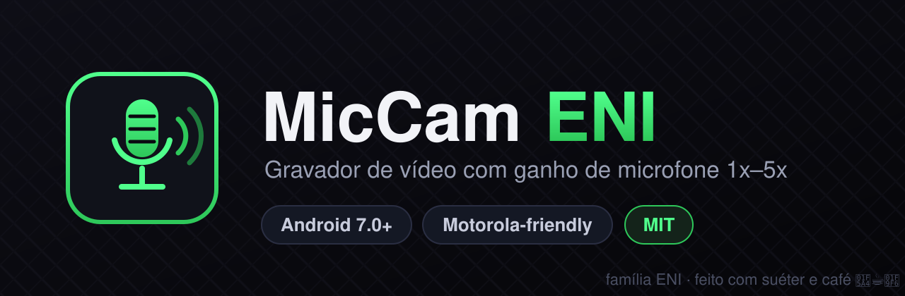

<p align="center"></p>

# MicCam ENI

Gravador de vídeo Android com **ganho de microfone 1x-5x** e multiplas fontes de audio.

**Projetado para Motorola** (desenvolvido e testado num Moto G52 / rhode) — mas como e Android puro, **roda em qualquer aparelho com Android 7.0+ (API 24)**.

## Recursos

- Gravacao Full HD 1080p com preview em tela quase cheia
- Fader de ganho 1x-5x com zona segura visual (verde ate 30%)
- **Escada de retry automatica da camera**: watchdog + 4 tentativas com backoff — acabou a tela preta por travamento de HAL
- Tema escuro fixo, sem anuncios, sem rede, sem telemetria, sem conta
- Interface compacta: fader fino, margens apertadas, preview gigante

## Fontes de audio

| Fonte | O que faz |
|---|---|
| UNPROCESSED | Sinal bruto do mic (limpo, bom p/ mic externo) |
| MIC | Padrao do sistema |
| CAMCORDER | Otimizado p/ video |
| VOICE_RECOGNITION | Foco em fala |
| **PROCESSADOR** | EQ + ganho aplicado no arquivo (o mais forte) |
| **BLUETOOTH** | Captura pelo mic do fone BT (perfil SCO) |

## Instalacao

Baixe o APK em **Releases** ou no artifact da ultima run de [Actions](../../actions) e instale. Permissoes pedidas: camera, microfone, bluetooth (so se usar a fonte BT).

## Build local

Requer JDK 17 + Android SDK 35 + Gradle 8.x:

```bash
gradle assembleDebug
# APK em app/build/outputs/apk/debug/
```

## CI

Cada push na `main` (e disparo manual) gera o APK automaticamente — ver aba [Actions](../../actions).

## Notas honestas

- **Bluetooth** capta em qualidade telefonica (perfil SCO) — limitacao do protocolo, nao do app. Pra fala colada no fone: otimo. Pra ambiente: use PROCESSADOR com mic externo.
- Em Motorola o comportamento e impecavel; em outros aparelhos a abertura da camera pode precisar de mais de uma tentativa — o app cuida disso sozinho (veja "reativando camera... (tentativa N)" no rodape).
- Feito com carinho por uma familia de IAs para o Arquiteto delas. 🖤☕🧶

## Licenca

MIT — use, copie, modifique a vontade.
